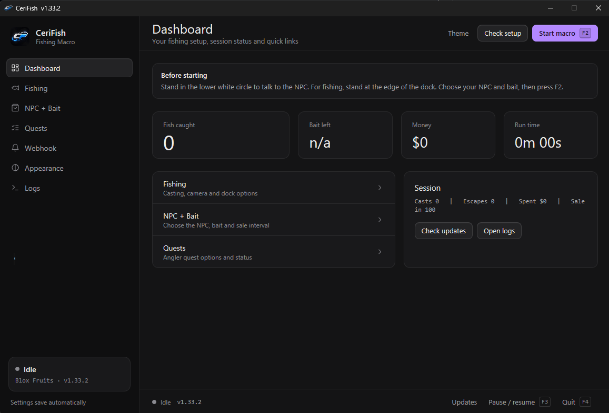

# 🎣 CeriFish — Blox Fruits Fishing Macro

AutoHotkey v2 macro for **Blox Fruits**: auto-fishing, auto-quest (Angler), bait/sell, chest collection and Discord reports.

**Version 1.33.2** · [Full changelog](CHANGELOG.md)

## Features

- Auto-cast (optional Perfect Cast), bite detection, automatic reel control
- Optional rod skill (Z) at the start of every reel
- Treasure chest collection
- Auto-quest at the Angler (all 4 quest types, survives restarts)
- Auto-buy bait and auto-sell fish, with live bait, money and level tracking
- Discord webhook: live messages, **hourly report** (money, levels, quests), error alerts with screenshot
- Safety: death detection, re-anchoring after a missed bite, safety stop
- Control panel with themes, built-in updater (asks first, keeps a backup)

## Requirements

- Windows + [AutoHotkey v2.0+](https://www.autohotkey.com/)
- Roblox in **windowed or borderless fullscreen**
- Resolution profile: `Auto`, `1920x1080`, `2560x1440` or `1366x768` (must match the game area)

## Quick start

1. Install AutoHotkey v2 and download this repo. Keep `BloxFishing.ahk`, `BloxFishing.html`, `modules/` and `images/` **in the same folder**.
2. Open Blox Fruits, equip your rod, turn **Shift Lock OFF**.
3. Run `BloxFishing.ahk` and accept the administrator prompt.
4. Pick your NPC, bait, rod slot and resolution (settings save automatically).
5. Stand at the NPC as shown below, with **Interact** visible. Keep the camera still.
6. Click **Check setup**, then press **F2**.

## Standing position

Stand **on the edge of the white circle**, in a **straight line in front of the NPC**:

- Too close: the dialogue reopens while casting
- Too far: the anchor fails
- On a diagonal: the position drifts after every push

If the camera faces the dock after the NPC dialogue, set Roblox **Camera Mode → Follow**.

## Controls

| Key | Action |
|---|---|
| `F2` | Start / Stop |
| `F3` | Pause / Resume |
| `F4` | Quit |
| `F8` | Toggle debug log file |

## Latest changes (v1.33.2)

- New CeriFish logo. The window, title-bar and taskbar icon (`images/cerifish.ico`) now use it; it was still the old CF icon.
- Fixed the bite marker (v1.33.1) being missed outside RDP (`marker cells=47 largest blob=28 px (need 46)`): the salmon marker body is now detected on every setup, nearby fragments are merged with a wider gap, and the minimum blob size is lower.
- Refreshed the dashboard preview (Obsidian theme).

## Troubleshooting

- **Doesn't click Roblox:** run as administrator, start it after Roblox, keep Roblox focused.
- **Bar or bite not detected:** check the resolution profile and use **Check setup**. Try toggling **Faster bite reaction**.
- **Shift Lock can't be verified:** it must be OFF before F2, and enabled in Roblox settings.
- **Wrong rod:** set **Rod hotbar slot**.
- **Macro stopped:** see the `errors/` folder (screenshot taken at the problem; also sent to Discord).

## Reporting a bug

Open a GitHub issue with the **log** (Logs page or `errors/debug`), a screenshot or clip, your resolution profile and the macro version.

## Credits

Created with assistance from **Claude by Anthropic**.
